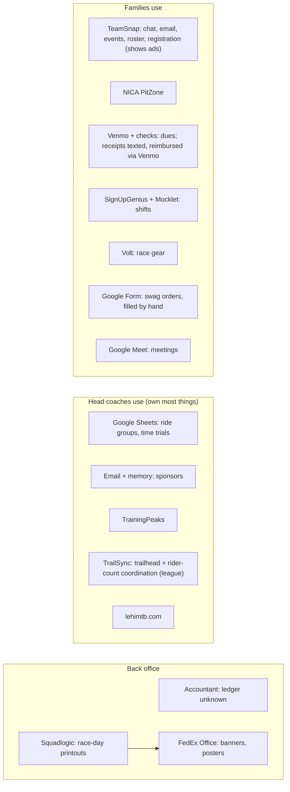
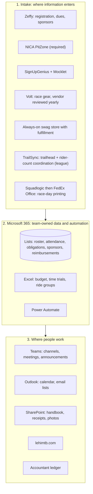
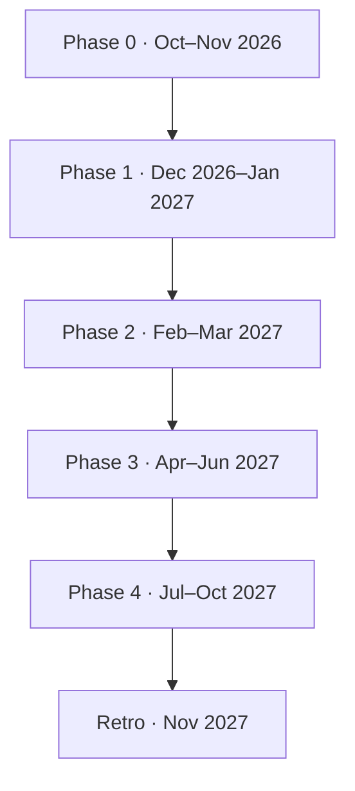

# Lehi MTB Capability Map: Current → Future State

**Audience:** coaches and parent leads. It's a handbook for running the team and handing roles off each year, plus the plan for improving our tools.
**Status:** draft from the planning interview on Oct 12–13, 2026. Items marked **(verify)** need confirmation before we build.

## Maturity scale

| Level | Name | Meaning |
|---|---|---|
| **0** | Not done | Nobody does it (or nobody knows if it's done) |
| **1** | Ad hoc | Lives in one person's head, texts or email |
| **2** | Repeatable | A known tool, done by hand the same way each year |
| **3** | Defined | Written down, named owner, template or checklist exists |
| **4** | Automated | Tools are connected; little manual work or re-keying |

## Decisions that shape the future state

1. **PitZone stays.** The league requires it (registration, licensing, waivers, race fees, results, incident reports). It has no API, so it's reconciled by hand.
2. **TeamSnap is retired.** It's too chatty, there's no control over who can post, and it doesn't enforce the two-adult rule.
3. **Microsoft 365 for Nonprofits becomes the backbone.** The Business Basic grant is free for up to 300 licenses. It includes:
   - **Teams** for comms and meetings (replacing Google Meet). Riders, ride leaders and parents join as **guests with their own email**, never lehimtb.com accounts. Guest chat settings and owner-only channels control who can post **(verify guest chat controls)**
   - **Lists, Forms, Excel and SharePoint** for data and documents
   - **Power Automate** to connect them
   - **Outlook** for email and the shared calendar
4. **Zeffy handles all money coming in:** dues, sponsorships and donations. It's free for 501(c)(3)s and sends tax receipts automatically.
5. **SignUpGenius stays for now** for team volunteer shifts, including race-food signups. Mocklet stays for league volunteer shifts, and **TrailSync stays for trailhead and rider-count coordination** (the league requires both).
6. **Volt stays for race gear (kits), but the vendor is re-evaluated every year.** Swag moves from a Google Form with hand fulfillment to an always-on team store with fulfillment. Squadlogic, FedEx Office, TrainingPeaks, Canva and the lehimtb.com website stay.
7. **Only coaches and role leads get lehimtb.com accounts.** Riders, ride leaders and parents are guests on their own email. Email to families goes out through a shared team mailbox.
8. **Every capability gets a named owner,** including a new Technical Director and a Food Committee. Today, anything without an owner falls to the head coaches.

---

## Architecture: current state

**What hurts:** most capabilities depend on the head coaches. Money is matched by hand. TeamSnap chat is noisy and uncontrolled. Nobody tracks attendance or skills. Sponsors live in memory.

## Architecture: future state

---

## Maturity summary

| Area | Now | Target | Gap |
|---|---|---|---|
| Rider & family | `█████░░░` 2.4 | `███████░` 3.3 | +0.9 |
| Volunteers | `████░░░░` 2.0 | `██████░░` 3.0 | +1.0 |
| Finance | `███░░░░░` 1.3 | `███████░` 3.3 | +2.0 |
| Sponsorship | `███░░░░░` 1.5 | `███████░` 3.5 | +2.0 |
| Apparel & merch | `█████░░░` 2.3 | `██████░░` 2.8 | +0.5 |
| Training | `███░░░░░` 1.5 | `██████░░` 3.0 | +1.5 |
| Practice ops | `████░░░░` 1.9 | `██████░░` 3.1 | +1.2 |
| Race ops | `████░░░░` 2.1 | `██████░░` 3.0 | +0.9 |
| Comms & marketing | `███░░░░░` 1.7 | `██████░░` 3.1 | +1.4 |
| Events & culture | `███░░░░░` 1.6 | `██████░░` 3.0 | +1.4 |
| Governance | `███░░░░░` 1.3 | `██████░░` 3.2 | +1.9 |
| Food committee | `████░░░░` 2.0 | `██████░░` 3.0 | +1.0 |
| Platform & data | `█░░░░░░░` 0.3 | `██████░░` 3.0 | +2.7 |

Each bar is out of 4 (8 blocks, 2 per level). Gap is target minus now.

**Biggest gaps** (where the effort pays off most): Platform and identity, Finance, Governance, Sponsorship, and Training (attendance and skills tracking are at 0).

---

## Capability detail

Columns: **Now** = current tool, current maturity. **Future** = future tool, target maturity. **Owner** = future owner.

### 1. Rider & Family Management

| Capability | Now | Future | Owner |
|---|---|---|---|
| Recruiting / outreach | Website, kickoff, word of mouth · **2** | Website + school and junior-high outreach plan, recruiting post schedule · **3** | Comms & Media Lead |
| Kickoff meeting | Website kickoff page, LHS auditorium · **3** | Same, plus run-of-show template in SharePoint · **3** | Head Coaches |
| Team registration | TeamSnap registration · **2** | Zeffy registration form (rider and guardian info, medical flags, sizes, consent) → Lists Roster · **4** | Team Director |
| League registration | PitZone · **3** | PitZone (unchanged); "PitZone ✓" column in Roster · **3** | Team Director |
| Roster (source of truth) | TeamSnap · **2** | Lists Roster: one row per rider; feeds Teams membership, attendance and obligations · **4** | Team Director |
| Waivers & medical | PitZone · **3** | PitZone; emergency info mirrored to a restricted Lists view for coaches and ride leaders · **3** | Team Director |
| Financial aid | Utah League aid + sponsor dues reduction · **2** | Same, plus a confidential Zeffy discount code per family; private Lists view for the Treasurer only · **3** | Treasurer |

### 2. Coach & Volunteer Management

| Capability | Now | Future | Owner |
|---|---|---|---|
| Coach and ride leader recruiting | Head coaches ask parents · **1** | Ask at kickoff + interest question in the registration form → recruiting list · **3** | Head Coaches |
| Licensing and training | PitZone · **3** | PitZone; Roster tracks license level and expiry, with a January reminder · **3** | Team Director |
| Ride leader onboarding | PitZone + website Rider Leader Toolkit · **3** | Same, plus shadow-ride checklist in Lists · **3** | Head Coaches |
| Team volunteer shifts (setup, tent, hydration, other) | SignUpGenius · **2** | SignUpGenius (kept) with season sheets created in one batch; race-food shifts are owned by the Food Committee · **3** | Volunteer Coordinator |
| League volunteer shifts | Mocklet · **2** | Mocklet (required); nudges via Teams · **3** | Volunteer Coordinator |
| Shift completion (1 league + 1 team shift per rider) | Not tracked · **1** | Lists Family Obligations tracker with a race-eligible flag · **3** | Volunteer Coordinator |
| Trail work hours (3+ to race) | Logged by hand on the trail → TeamSnap → NICA · **2** | Microsoft Form on the trail → Family Obligations → entered in NICA · **3** | Trail Work Coordinator |

### 3. Finance

| Capability | Now | Future | Owner |
|---|---|---|---|
| Dues collection | Venmo @lehimtb and checks, matched by hand · **1** | Zeffy (card/ACH, installments, auto receipts) · **4** | Treasurer |
| League fees | PitZone · **3** | PitZone (unchanged) · **3** | Families / Team Director |
| Reimbursements | Receipts texted to a coach, reimbursed via Venmo · **1** | Form + receipt photo → Power Automate approval (head coach) → SharePoint `/Finance/Receipts` → accountant notified → Zelle/ACH (Venmo only as fallback) · **4** | Treasurer |
| Budget vs actuals | Unknown · **1** | Excel workbook in SharePoint fed by Zeffy exports and the Reimbursements list; reviewed monthly · **3** | Treasurer |
| Bookkeeping / ledger | Accountant (tool unknown) · **1** | Accountant's ledger (find out what it is), monthly bank reconciliation · **3** | Treasurer + Accountant |
| Sponsor credit toward dues | Head coaches calculate · **1** | Sponsor form records the credited family → Treasurer issues a Zeffy discount code · **3** | Sponsor Lead + Treasurer |

### 4. Sponsorship

| Capability | Now | Future | Owner |
|---|---|---|---|
| Prospecting | Head coaches, from memory · **1** | Lists Sponsors pipeline (prospect → asked → committed → paid → logo → recognized) · **3** | Sponsor Lead |
| Tiers and packages | Defined on the website · **3** | Same, plus a one-page PDF in SharePoint · **3** | Sponsor Lead |
| Invoicing and payment tracking | Email · **1** | Zeffy sponsorship form → auto tax receipt → Lists row updated · **4** | Sponsor Lead |
| Logo collection (vector, due Apr 15) | Email · **1** | Logo upload on the Zeffy form or a Microsoft Form → SharePoint `/Sponsors/Logos` · **4** | Sponsor Lead |
| Recognition (jersey, banner, website, pool party) | Website carousel, banner · **2** | Recognition checklist per sponsor in Lists; Teams thank-you post · **3** | Sponsor Lead + Comms |
| Renewals | Memory · **1** | Automatic January renewal email to last year's sponsors (before kit design) · **4** | Sponsor Lead |

### 5. Apparel & Merch

| Capability | Now | Future | Owner |
|---|---|---|---|
| Annual merch vendor review (race gear and swag) | Volt by default each year · **1** | Each fall, compare vendors on price, quality, lead time, minimums and store features; record the decision before kit design starts · **3** | Apparel Lead + Head Coaches |
| Kit design and vendor timeline | Head coaches + Volt · **2** | Timeline template: confirm vendor → design → sponsor logos → proof → order window → delivery · **3** | Apparel Lead |
| Fitting | Size samples at kickoff · **3** | Same · **3** | Apparel Lead |
| Race gear ordering | Volt team store · **3** | Confirmed vendor's store (Volt today); order-complete column in Roster · **3** | Apparel Lead |
| Race gear distribution | Coaches hand out at practice · **2** | Pickup checklist from Roster (sign-off per rider) · **3** | Apparel Lead |
| Swag and fan gear ordering (hats, socks, stickers, shirts) | Google Form · **2** | Always-on team store, open year-round · **4** | Apparel Lead |
| Swag fulfillment | By hand · **1** | Store vendor prints and ships (or drop-ships) to families; no hand fulfillment · **4** | Apparel Lead |
| Swag vendor | Unknown · **1** | Chosen in the annual vendor review; evaluate print-on-demand and team-store vendors **(verify options)** · **3** | Apparel Lead |

### 6. Training & Development (the "what": practice planning)

| Capability | Now | Future | Owner |
|---|---|---|---|
| Season plan / periodization | TrainingPeaks, coaches · **2** | Season plan doc in SharePoint, aligned to TrainingPeaks blocks · **3** | Head Coaches |
| Weekly session plans | Coaches' heads / Google Docs · **1** | Session plan template (warm-up, skill focus, main set, groups) in SharePoint; posted to the Coaches channel weekly · **3** | Head Coaches |
| Skills training and progression | Pre-season sessions; no tracking · **0** | Skills checklist per rider in Lists (cornering, braking, climbing, descending, drops, etc.), assessed at the baseline and each time trial · **3** | Head Coaches + Assistant Coaches |
| Fitness / endurance plans | TrainingPeaks (code LEHIMTB), optional · **2** | TrainingPeaks; recommended for JV/Varsity · **3** | Head Coaches |
| Time trials | Google Sheets · **2** | Excel in SharePoint (migrated) · **3** | Head Coaches |
| Ride group placement | Google Sheets · **2** | Excel/Lists, informed by time trials + skills + attendance · **3** | Head Coaches |
| Race prep (pre-rides, staging, tactics, nutrition) | Website race-day page · **2** | Race-prep curriculum mapped to the weeks before Race 1 · **3** | Head Coaches |
| Coach and ride leader briefings | Ad hoc · **1** | Weekly brief posted in the Coaches & Leaders channel · **3** | Head Coaches |

### 7. Practice Operations (the "how": running practice)

| Capability | Now | Future | Owner |
|---|---|---|---|
| Locations and schedule | TeamSnap + website Practices page · **2** | Outlook shared calendar + Practices channel (owners post) · **3** | Head Coaches / Team Director |
| Ride leader assignments and ratios (6:1) | Coaches, Sheets · **2** | Assignment view in Lists, ratio check per group · **3** | Head Coaches |
| Attendance | Not tracked · **0** | Lists check-in by ride leaders (mobile) → weekly summary via Power Automate · **4** | Ride Leaders / Team Director |
| Trailhead and rider-count coordination (league requirement) | TrailSync · **3** | TrailSync (kept, required): book trailheads and rider counts so no trailhead is overwhelmed; ride group sizes in Lists feed the numbers · **3** | Head Coaches |
| Weather calls | TeamSnap + OpenSnow · **2** | Announcement post in Teams + calendar update · **3** | Head Coaches |
| Safety / EAP | Google Docs, Rider Leader Toolkit · **3** | EAPs in SharePoint, pinned in Teams · **3** | Head Coaches |
| Incident reporting | PitZone (NICA) · **2** | PitZone + internal incident log in Lists (restricted) · **3** | Head Coaches |
| Trail work days | Coaches schedule · **2** | Calendar events + hour logging Form · **3** | Trail Work Coordinator |

### 8. Race Operations

| Capability | Now | Future | Owner |
|---|---|---|---|
| Race registration | PitZone · **3** | PitZone (unchanged) · **3** | Families / Team Director |
| Race-day materials (start lists, wave/staging sheets, rider cards) | Squadlogic from PitZone data · **3** | Same · **3** | Race Day Captain |
| Printing | FedEx Office · **2** | FedEx Office with a print checklist and lead times · **3** | Race Day Captain |
| Tent, trailer and setup | Coaches · **2** | Equipment Manager + Race Day Captain with a load-out checklist · **3** | Equipment Manager |
| Race-day volunteers | SignUpGenius + Mocklet · **2** | Same, plus the obligations tracker · **3** | Volunteer Coordinator |
| Race-week comms | TeamSnap + website · **2** | Races channel post template (T-7, T-2, race morning) · **3** | Race Day Captain + Comms |
| Results and recognition | NICA results · **2** | Results shout-out post + photo album per race · **3** | Comms & Media Lead |
| Travel and lodging (Richfield, Panguitch, St. George) | Unknown · **1** **(verify)** | Lodging plan booked in the off-season, with a family info sheet · **3** | Race Day Captain |

### 9. Food Committee

| Capability | Now | Future | Owner |
|---|---|---|---|
| Committee and roster | One Food Lead; signups and tracking in Google Sheets · **2** | Food Committee: a chair plus 3–5 parents, a one-page charter and a season roster · **3** | Food Committee Chair |
| Menu, dietary and allergy plan | Food Lead, tracked in Google Sheets · **2** | Menu templates per race; allergy and dietary list from the Roster (restricted view); sheets move to Excel in SharePoint · **3** | Food Committee |
| Per-race budget and shopping | Google Sheets; Food Lead buys, reimbursed via Venmo · **2** | Per-race budget in Excel (migrated from Sheets) and a shopping list template; reimbursed via the Form → Zelle/ACH · **3** | Food Committee + Treasurer |
| Food volunteer signups | SignUpGenius · **2** | SignUpGenius (team volunteer sheets) created by the committee for each race · **3** | Food Committee + Volunteer Coordinator |
| Tent kitchen and race-day service (hot lunch 10–2, snacks, volunteer meals) | Food Lead, with the committee's sheets · **2** | Day-of runbook and equipment checklist (stoves, coolers) shared with the Equipment Manager · **3** | Food Committee |
| Food safety and handling | Unknown · **1** | One-page checklist (temperatures, handwashing, labeling) **(verify league rules)** · **3** | Food Committee |
| In-kind food donations | Ad hoc · **1** | Tracked in the Sponsors list with a thank-you · **3** | Food Committee + Sponsor Lead |

### 10. Communications & Marketing

| Capability | Now | Future | Owner |
|---|---|---|---|
| Announcements | TeamSnap (noisy) · **2** | Teams Announcements channel, owners only · **4** | Head Coaches / Comms |
| Team chat | TeamSnap chat (uncontrolled, shows ads) · **1** | Teams channels with threads. Riders, ride leaders and parents are guests with guest chat settings tightened **(verify)**; ride-group channels always have 2+ coaches · **3** | Technical Director |
| Email to families | TeamSnap email · **2** | Shared team mailbox sends to personal-email contacts kept in sync from the Roster · **3** | Technical Director |
| Meetings (coach, leader and parent) | Google Meet · **2** | Teams meetings with recurring links in the calendar · **3** | Technical Director |
| Website | Next.js on GitHub Pages, maintained by one volunteer · **3** | Same, plus embedded team calendar and links to Zeffy forms · **4** | Technical Director |
| Social media | Minimal, ad hoc · **1** | Simple cadence (race weekends, sponsor thank-yous) · **2** | Comms & Media Lead |
| Photos | Head coach + photo volunteers · **1** | SharePoint photo library per event; one upload link · **3** | Comms & Media Lead |
| Print and graphic design | Canva + FedEx · **2** | Canva brand kit + templates · **3** | Comms & Media Lead |

### 11. Events & Culture

| Capability | Now | Future | Owner |
|---|---|---|---|
| Family Camp (Moab, June) | Andre, website page · **3** | Same, plus template in SharePoint · **3** | Andre (Family Camp Director) |
| Banquet and awards | Ad hoc · **1** | Banquet playbook (venue, awards list, slideshow) · **3** | Events Lead |
| Sponsor pool party | Ad hoc · **1** | Part of the Events playbook; invite list from Sponsors · **3** | Events Lead + Sponsor Lead |
| GRiT (Girls Riding Together) | Devin · **2** | GRiT channel + event series on the calendar · **3** | Devin (GRiT Coach) |
| Rider leadership | None · **0** | Rider Leadership Council (captains) with a charter · **3** | Head Coaches |

### 12. Governance & Compliance

| Capability | Now | Future | Owner |
|---|---|---|---|
| Roles and handoff | Head coaches by default · **1** | Role charters + handoff checklists (see the process map) · **3** | Head Coaches |
| Document repository | Scattered Google Docs · **1** | SharePoint team site: Handbook, Finance, Sponsors, Safety, Archive · **3** | Team Director |
| Safe comms with minors (two-adult rule) | Not enforced in TeamSnap · **1** | Guest chat settings plus owner-only channels; ride-group channels always include 2+ coaches · **4** **(verify)** | Technical Director |
| NICA / league compliance, insurance | PitZone / League · **3** | Same; compliance checklist per phase · **3** | Head Coaches |
| Records and data retention | None · **1** | Annual archive in November; medical/aid data purged per policy · **3** | Team Director |
| Season retrospective | Informal · **1** | November retro with all leads; changes logged · **3** | Head Coaches |

### 13. Platform & Data (enabling)

| Capability | Now | Future | Owner |
|---|---|---|---|
| Identity and accounts | Personal accounts everywhere · **0** | M365 tenant on lehimtb.com with accounts for coaches and role leads only. Riders, ride leaders and parents are guests on their own email · **3** | Technical Director |
| Integrations | None · **0** | Power Automate (included connectors) + Zapier free tier for Zeffy · **3** | Technical Director |
| Reporting | Ad hoc · **1** | Roster, obligations, attendance and budget dashboards (Lists views + Excel) · **3** | Technical Director |

---

## Tool rationalization

| Tool | Decision | Role in the future state | Est. cost/yr |
|---|---|---|---|
| TeamSnap | **Retire** (read-only through May 2027) | Replaced by Teams, Lists, Outlook, Zeffy. Also shows ads to families | Saves the current subscription |
| Microsoft 365 Business Basic (Nonprofit) | **Add** | Teams, Outlook, Lists, Forms, Excel, SharePoint, Power Automate | \$0 (grant, up to 300 licenses) |
| Zeffy | **Add** | Registration + dues, sponsorships, donations, tax receipts | \$0 (optional payer tip) |
| Zapier | **Add (maybe)** | Zeffy → Lists sync (or weekly CSV instead) | \$0 on the free tier |
| Venmo | **Demote** | Fallback only (reimbursements and dues move off it) | \$0 |
| Google Meet | **Retire** | Replaced by Teams meetings | \$0 |
| Google Form for swag orders | **Retire** | Replaced by an always-on swag store | \$0 |
| Google Sheets | **Retire** | Migrated to Excel/Lists | \$0 |
| PitZone | Keep (required) | League system of record | League fees |
| SignUpGenius | Keep | Team volunteer shifts, race-food signups | Current tier |
| Mocklet | Keep (required) | League volunteer shifts | \$0 |
| TrailSync | Keep (required) | Trailhead and rider-count coordination | League-provided |
| Squadlogic | Keep | Race-day printouts | Current |
| FedEx Office | Keep | Printing | Per job |
| Volt | Keep, review yearly | Race gear (kits). Re-evaluated every fall | Per order |
| Swag store vendor | **Add** | Always-on store with fulfillment; vendor chosen in the annual review | Varies (verify) |
| TrainingPeaks | Keep | Training plans | Free with code |
| Canva | Keep | Graphics | Current |
| lehimtb.com | Keep | Public info hub | GitHub Pages, \$0 |

---

## Roadmap

| Phase | Key deliverables | Exit criteria |
|---|---|---|
| **0** | M365 Nonprofit grant approved; Zeffy account verified; accountant ledger identified; Technical Director, Team Director, Sponsor, Apparel, Race Day, Comms, Events, Trail and Food Committee roles filled | Tenant live on lehimtb.com; roles named |
| **1** | Teams structure and policies; Lists (Roster, Attendance + Skills, Family Obligations, Sponsors, Reimbursements); Excel budget; reimbursement flow; Zeffy registration and sponsorship forms; Google Sheets migrated; recurring meetings moved from Google Meet to Teams; merch vendor review done and swag store vendor chosen | 10 coaches/ride leaders use it for 4 weeks |
| **2** | Sponsor renewals sent in January; swag store live; kickoff deck shows the new registration flow; family onboarding guide on the website | 90% of returning families in Teams by Apr 13 |
| **3** | TeamSnap read-only; attendance and skills tracking live at pre-season sessions | No TeamSnap posts after May; subscription cancelled |
| **4** | Per-race loop run 5 times on the new stack | All 5 races run without TeamSnap |

---

## Risks and open questions

> [!WARNING]
> **Guest chat controls (verify).** With riders, ride leaders and parents as guests, we can no longer rely on per-user messaging policies. Confirm in the Teams admin center that guest chat can be turned off, and that guests can still post and reply in channels. If it can't, fall back to channel-only rules or to Google Chat on Workspace for Nonprofits.

- **Teams is heavy for parents.** Keep parent-facing channels to three (Announcements, Practices, Races) and post a 1-page "How to use Teams" guide.
- **Guests, not lehimtb.com accounts.** Guests have no Outlook mailbox or calendar: email goes through the shared team mailbox, and families get the calendar from a subscribe link and the website. Guests sign in with a Microsoft account or an emailed one-time code.
- **Younger riders (verify).** A personal Microsoft account for a child under 13 needs parental consent through Microsoft Family Safety. High school riders are usually 13+, but eighth graders recruited early may need a parent-created account.
- **Lists and SharePoint for guests (verify).** Ride leaders need edit access to the attendance list as guests. Test it in the Lists mobile app before relying on it.
- **Guest list upkeep.** Add guests when a rider registers and remove them each November. The Technical Director owns this.
- **Lists offline check-in (verify).** Test the Lists mobile app on a trail with no signal. Fallback: a paper sheet photo, entered after the ride.
- **Zeffy → Lists sync.** Power Automate has no Zeffy connector. Use the Zapier free tier (enough for about 80 registrations) or a weekly CSV import.
- **Zeffy tip prompt.** Payers see an optional tip. Tell families in advance that it's optional.
- **PitZone reconciliation stays manual.** Budget about 30 minutes a week during registration.
- **Privacy.** Medical, aid and incident data go in restricted Lists views. Keep the website and this document free of personal data. lehimtb.com is public, so an "operations" page would be unlisted, not private.
- **Open:** What ledger does the accountant use? How is lodging for away races handled today? Do we have TeamSnap data to export before it's cancelled (rosters, history)?
