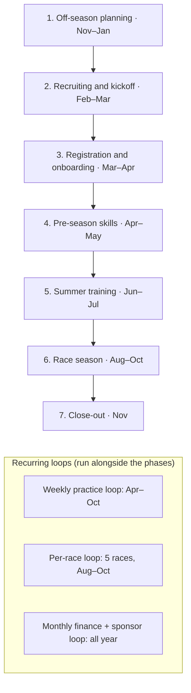
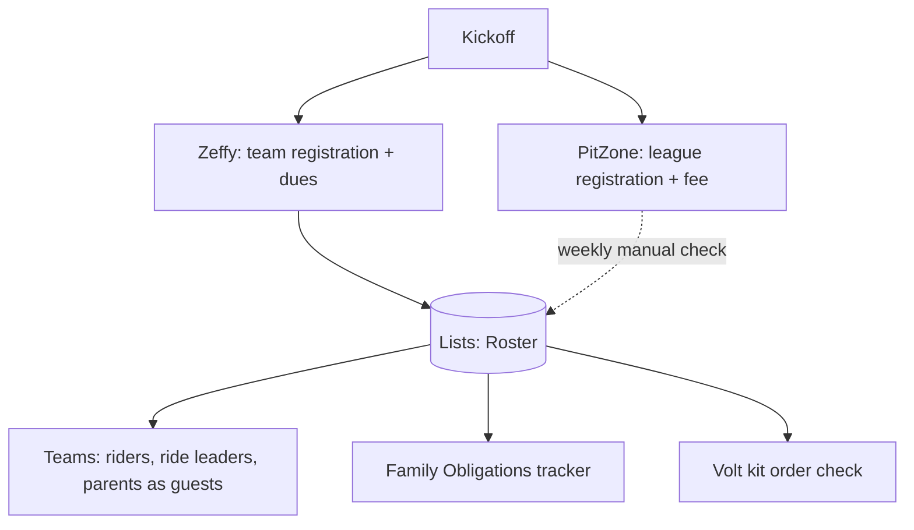
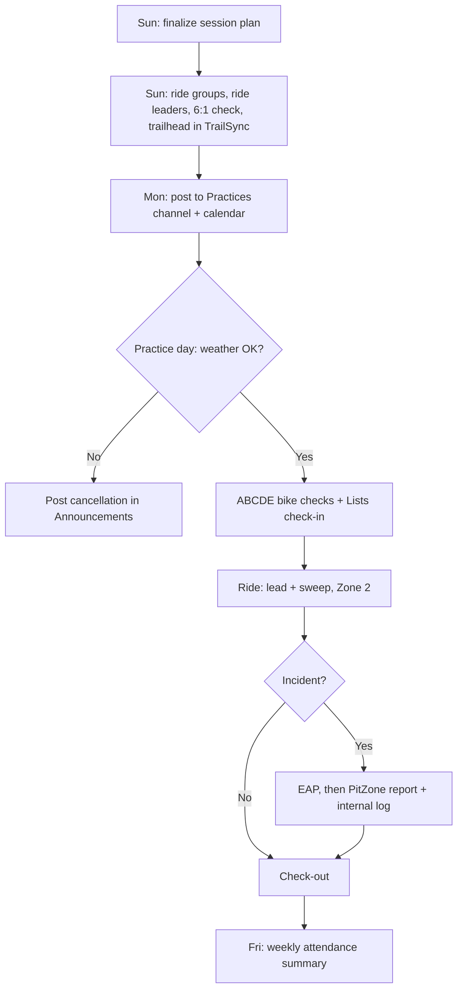
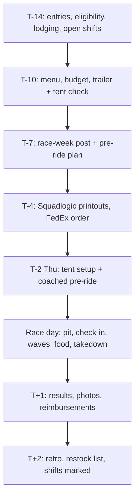
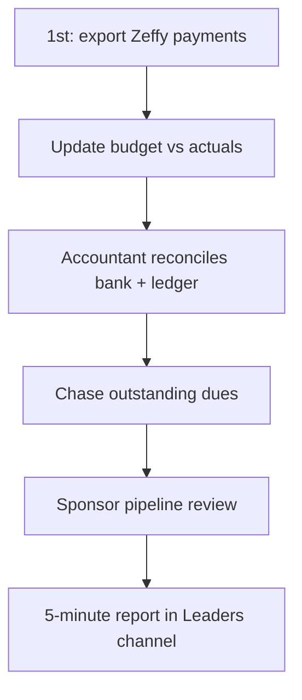

# Lehi MTB Process Map: Running a High School Team

**Companion to:** [Capability map](/operations/capability-map)
**How to read it:** the season runs in 7 phases plus 3 recurring loops. Each step lists its owner, its tool (**current → future**), when it's due, and what it hands off. Dates are based on the 2026 season; roll them forward each year.

---

## Season overview

---

## Areas of ownership

| Role | Who (today) | Charter (one line) | Handoff essentials |
|---|---|---|---|
| **Head Coaches** (HC) | Steve, Randall | Own the season plan, coaching, safety, final decisions and approvals | Season plan, EAPs, coach roster, budget sign-off |
| **Assistant / GRiT Coaches** (AC) | Aaron, Andre, Devin | Run groups and skills, GRiT program, Family Camp (Andre) | Skills checklist, GRiT calendar, camp template |
| **Team Director** (TD) | *Open* | Admin backbone: registration, roster, PitZone reconciliation, calendar, records | Roster list, calendar, archive |
| **Technical Director** (TX) | *Open* | Owns the platform: M365 tenant and guests, Power Automate, Zapier, website, integrations | Tenant admin access, automation inventory, website repo, guest list |
| **Treasurer** (TR) | Exists + accountant | Money in, money out, budget vs actuals, aid (confidential) | Bank access, Zeffy admin, budget workbook |
| **Sponsor Lead** (SL) | *Open* | Sponsor pipeline, payments, logos, recognition, renewals | Sponsors list, tier sheet, logo library |
| **Apparel & Swag Lead** (AL) | *Open* | Annual merch vendor review, kit timeline, fitting, orders, distribution, swag store | Vendor decision record, timeline, size samples, store admin |
| **Volunteer Coordinator** (VC) | Exists | SignUpGenius sheets, Mocklet nudges, Family Obligations tracker | SUG account, obligations list |
| **Trail Work Coordinator** (TW) | *Open* | Trail days, hour logging, entering hours in NICA | Trail partner contacts, hour form |
| **Race Day Captain** (RC) | *Open* | Race logistics: tent plan, printing, lodging, race-week comms | Race checklist, Squadlogic login, lodging contacts |
| **Food Committee** (FC) | Food Lead exists; committee to be formed | Race-day food: menus, budget, shopping, volunteers, tent kitchen | Menu template, budget per race, equipment checklist |
| **Equipment / Trailer Manager** (EQ) | Exists | Trailer, tent, tools, inventory, load-out | Inventory list, trailer keys/registration |
| **Comms & Media Lead** (CM) | *Open* (photo volunteers help today) | Announcements cadence, social, photos, Canva templates | Brand kit, photo library, post templates |
| **Events Lead** (EV) | *Open* | Banquet, awards, sponsor pool party | Banquet playbook, awards list |
| **Rider Leadership Council** (RLC) | *New* | Rider voice, peer mentoring, tent help, culture | Charter, captain duties |
| **Ride Leaders** (RL) | Parent volunteers | Lead and sweep groups, ABCDE checks, check-in, incidents | Toolkit, EAPs, group assignments |

---

## Phase 1: Off-season planning (Nov–Jan)

| # | Step | Owner | Tool (current → future) | Due | Output / handoff |
|---|---|---|---|---|---|
| 1.1 | Season retro with all leads | HC | Informal → Teams meeting + retro doc in SharePoint | Mid-Nov | List of changes for the next season |
| 1.2 | Close the books; next-season budget draft | TR + accountant | Venmo/receipts → Excel budget workbook | Dec 15 | Budget, proposed dues |
| 1.3 | Set dues, fee schedule, aid policy | HC + TR | Memory → budget workbook + decision log | Dec 31 | Dues amount, installment plan, aid rules |
| 1.4 | Confirm coaches; recruit open parent roles | HC | Asking around → role charters + Teams Leaders channel | Jan 15 | Named owner for every role |
| 1.5 | Coach/ride leader license renewals | TD | PitZone → PitZone + Roster expiry reminder | Jan 31 | Renewal list sent |
| 1.6 | Sponsor renewals + new prospects | SL | Email/memory → Lists Sponsors + Zeffy sponsorship form | Start Jan 5 | Renewal emails out; pipeline updated |
| 1.7 | **Confirm merch vendors** (race gear and swag): compare price, quality, lead time, minimums and store features; record the decision | AL + HC | Volt by default → annual vendor review | Nov 30 | Vendor decision for the season; swag store vendor chosen |
| 1.8 | Kit design + vendor timeline | AL + HC | Head coaches + Volt → timeline template | Jan 31 | Design brief, sponsor logo slots, order window dates |
| 1.9 | Practice locations, permits, trail partners | HC | Memory → locations list in SharePoint | Jan 31 | Approved locations per day of week |
| 1.10 | Book lodging for away races | RC | Unknown → lodging plan | Jan 31 **(verify)** | Lodging blocks for Richfield, Panguitch, St. George |
| 1.11 | Publish the season calendar | TD | TeamSnap → Outlook shared calendar + website embed | Jan 31 | Calendar link for families |
| 1.12 | Platform setup (first year only) | TX | n/a → M365 tenant, guest access, Teams, Lists, Zeffy forms; move recurring meetings from Google Meet to Teams | Jan 31 | Pilot ready (see roadmap) |

## Phase 2: Recruiting & kickoff (Feb–Mar)

| # | Step | Owner | Tool (current → future) | Due | Output / handoff |
|---|---|---|---|---|---|
| 2.1 | Rider recruiting (LHS + feeder junior highs, past families) | CM + HC | Website/word of mouth → recruiting plan + flyers (Canva → FedEx) | Feb–Mar | Interest list |
| 2.2 | Book the LHS auditorium; build the kickoff deck | HC | Website kickoff page → run-of-show template | Mar 1 | Room + deck |
| 2.3 | Order size samples from Volt | AL | Volt → Volt | Mar 1 | Samples on hand |
| 2.4 | Zeffy registration form live; PitZone instructions ready | TD | TeamSnap → Zeffy + website /register | Kickoff day | Registration link |
| 2.5 | **Kickoff meeting** (returning 6:15, new 7:15) | HC | Same | Late Mar | Families know the steps, fees and dates; sizes tried on |
| 2.6 | Recruit ride leaders + volunteers at kickoff | HC + VC | Ad hoc → interest question on the registration form | Kickoff | Ride leader pipeline |
| 2.7 | Swag store live (always on, with fulfillment) | AL | Google Form + hand fulfillment → vendor store | Mar 15 | Families can order swag year-round |

## Phase 3: Registration & onboarding (Mar–Apr)

| # | Step | Owner | Tool (current → future) | Due | Output / handoff |
|---|---|---|---|---|---|
| 3.1 | Families register + pay dues (installments available) | Families | TeamSnap + Venmo/check → Zeffy | Apr 13 | Roster row created |
| 3.2 | Families complete PitZone + league fee | Families | PitZone → PitZone | Apr 13 | PitZone ✓ |
| 3.3 | Weekly reconciliation: Zeffy ↔ PitZone ↔ Roster; chase the gaps | TD | Manual → Roster status columns | Weekly to Apr 13 | Missing-items list |
| 3.4 | Invite riders, ride leaders and parents as Teams guests (personal emails, no lehimtb.com accounts); add them to the family mailing list; send the calendar link | TX | TeamSnap invite → guest invites from Roster | Within 3 days of registering | Families in Teams |
| 3.5 | Apply sponsor credit to dues | SL + TR | Head coach math → Zeffy discount code | Before Apr 13 | Discount codes issued |
| 3.6 | Scholarship / aid requests | TR | Ad hoc → confidential form + private view | Apr 13 | Aid decisions |
| 3.7 | Sponsor logos collected (vector) | SL | Email → upload form → SharePoint | **Apr 15** | Logo pack to Volt |
| 3.8 | Kit orders in the Volt store; final design to Volt | AL | Volt → Volt + Roster order column | Volt window | Order confirmed |
| 3.9 | Ride leader licensing in PitZone | TD + HC | PitZone → PitZone + Roster | May 1 | Licensed ride leaders |
| 3.10 | Create the season's SignUpGenius team volunteer sheets; explain obligations | VC | SignUpGenius → SignUpGenius + obligations list | Apr 30 | Shift sheets live |

## Phase 4: Pre-season skills (Apr–May)

| # | Step | Owner | Tool (current → future) | Due | Output / handoff |
|---|---|---|---|---|---|
| 4.1 | ~8 weekly skills sessions (new riders attend 2+) | HC + AC | Coaches → session plan template | Apr–May | Session plans in SharePoint |
| 4.2 | **Skills baseline** for every rider | HC + AC | None → Lists skills checklist | First 2 sessions | Baseline per rider |
| 4.3 | Attendance check-in at every session | RL | None → Lists check-in | Every session | Attendance data |
| 4.4 | Time trial #1 → initial ride groups | HC | Google Sheets → Excel/Lists | Mid-May | Ride groups published in Teams |
| 4.5 | Ride leader shadow rides | HC | Ad hoc → shadow checklist | May | Ride leaders cleared to lead |
| 4.6 | Trail work day #1 | TW | By hand → calendar + hours form | May | Hours logged |
| 4.7 | Family Camp planning (Moab, early June) | Andre | Website page → camp template | May 15 | Camp logistics |
| 4.8 | Cut over from TeamSnap; it goes read-only (2027 only) | TX | TeamSnap → Teams | May 31 | TeamSnap cancelled |

## Phase 5: Summer training (Jun–Jul)

| # | Step | Owner | Tool (current → future) | Due | Output / handoff |
|---|---|---|---|---|---|
| 5.1 | Regular practices 2–3x/week (see the weekly loop) | HC | TeamSnap → Teams + calendar + Lists | Jun 1 → | Attendance, incidents |
| 5.2 | Family Camp | Andre | Same | Early Jun | Camp done |
| 5.3 | Time trial #2 + skills re-check; adjust groups | HC + AC | Sheets → Excel/Lists | Early Jul | Updated groups |
| 5.4 | Race-prep curriculum (pre-ride, staging, nutrition, tactics) | HC | Website page → curriculum in session plans | Jul–Aug | Riders race-ready |
| 5.5 | League shift signup push (Mocklet) | VC | Mocklet → Mocklet + Teams nudges | Jul 31 | Every family signed up |
| 5.6 | Trail work days; enter hours in NICA | TW | By hand → TeamSnap → NICA, becomes Form → obligations → NICA | Before Race 1 | 3+ hours per rider |
| 5.7 | League aid / loaner bike window | TR | League → League | Jul 15–Aug 6 | Applications submitted |
| 5.8 | Race season plan: tent, food budget, printing lead times | RC + FC + EQ | Coaches → race checklist | Aug 1 | Plan for 5 races |
| 5.9 | Kit distribution | AL | Coaches at practice → pickup sign-off from Roster | Before Race 1 | Every rider kitted |
| 5.10 | **Race eligibility check** (PitZone ✓, trail hours, shifts signed up) | VC + TD | None → obligations "eligible" flag | 7 days before Race 1 | Eligibility list to HC |

## Phase 6: Race season (Aug–Oct)

Runs the **per-race loop** 5 times. The 2026 races were Aug 22, Sep 5, Sep 26, Oct 10 (Region 5 Championship) and Oct 23–24 (State, St. George). The weekly practice loop and monthly finance loop keep running alongside.

| # | Step | Owner | Tool | Due | Output / handoff |
|---|---|---|---|---|---|
| 6.1 | Per-race loop (below) | RC | See loop | Each race | Race run |
| 6.2 | Mid-season ride group and category review | HC | Excel/Lists | After Race 2 | Adjusted groups |
| 6.3 | Sponsor recognition at races (banner, tent) | SL + CM | Lists recognition checklist | Each race | Recognition delivered |
| 6.4 | Post-season qualifiers (e.g., NICA Western Regionals) | HC | PitZone / league | After State | Travel plan if needed |

## Phase 7: Close-out (Nov)

| # | Step | Owner | Tool (current → future) | Due | Output / handoff |
|---|---|---|---|---|---|
| 7.1 | Banquet + awards | EV | Ad hoc → banquet playbook | Early Nov | Banquet held |
| 7.2 | Sponsor thank-you + recognition report | SL | Email → Lists report + Teams post | Nov 15 | Report sent; renewal list ready |
| 7.3 | Equipment inventory, trailer winterized | EQ | Memory → Lists inventory | Nov 15 | Inventory + replacement list |
| 7.4 | Financial close; final budget vs actuals | TR + accountant | Unknown → Excel workbook | Nov 30 | Year-end report |
| 7.5 | Data archive + privacy purge | TD | None → SharePoint Archive | Nov 30 | Season archived; sensitive data removed |
| 7.6 | Role handoffs (each lead updates their checklist) | All leads | None → SharePoint role pages | Nov 30 | Next-year owners briefed |
| 7.7 | Season retro (feeds 1.1) | HC | Informal → retro doc | Mid-Nov | Improvement backlog |

---

## Loop A: Weekly practice cycle

| Step | Owner | Tool (future) |
|---|---|---|
| Session plan | HC | SharePoint template |
| Assignments + ratios + trailhead | HC | Lists assignment view; TrailSync for trailhead and rider count |
| Practice post | HC / CM | Teams Practices channel + Outlook calendar |
| Weather call | HC | OpenSnow → Teams Announcements |
| Check-in / check-out | RL | Lists mobile |
| Incident | RL → HC | EAP (SharePoint), PitZone, Lists incident log |
| Weekly summary | TX (automated) | Power Automate → Coaches channel |

## Loop B: Per-race cycle (T-14 days → T+2)

| When | Step | Owner | Tool (current → future) |
|---|---|---|---|
| T-14 | Confirm race entries; eligibility list; lodging; open food and tent shifts | TD, VC, FC, RC | PitZone; SignUpGenius; obligations list |
| T-10 | Menu, shopping list, budget; trailer and tent inspection | FC, EQ | Menu template; inventory list |
| T-7 | Race-week post (times, parking, pit rules, no dogs, no camping); pre-ride plan | RC + CM | TeamSnap → Teams Races channel template |
| T-4 | Print start lists, wave/staging sheets, rider cards | RC | Squadlogic → FedEx Office |
| T-2 | Tent setup Thu 3–5 PM; coached pre-ride 3–6 PM | EQ + HC | Load-out checklist |
| T-0 | Pit opens 6:45 (gate locks 8:00); check-in table; wave meetings (1 hr before); staging (15 min before); food 10–2; volunteers on shift; takedown | RC, FC, HC, RL, RLC | Race checklist; SignUpGenius roster |
| T+1 | Results + photo album; sponsor recognition post; reimbursements submitted | CM, SL, FC | Teams; SharePoint photos; reimbursement Form |
| T+2 | Retro (keep/fix), restock list, shift completion marked | RC, EQ, VC | Race retro note; obligations list |

## Loop C: Monthly finance + sponsor cycle

| Step | Owner | Tool (current → future) |
|---|---|---|
| Export payments | TR | Venmo history → Zeffy export |
| Budget vs actuals | TR | Unknown → Excel in SharePoint |
| Reimbursement approvals (continuous) | HC approves, TR pays | Venmo → Form → Power Automate approval → Zelle/ACH |
| Bank + ledger reconciliation | Accountant | Accountant's ledger |
| Dues chase | TR + TD | Manual → Zeffy installment status + Roster |
| Sponsor review | SL | Memory → Lists Sponsors board |

---

## Month-by-month calendar

| Month | Key activities | Main owners |
|---|---|---|
| **Jan** | Sponsor renewals out; kit design + Volt timeline; lodging booked; licenses renewed; calendar published | SL, AL, RC, TD |
| **Feb** | Recruiting push; kit proof; kickoff deck | CM, AL, HC |
| **Mar** | Size samples; **kickoff (late Mar)**; registration opens | HC, AL, TD |
| **Apr** | Registration + dues (Apr 13); sponsor logos (Apr 15); Volt orders; skills sessions begin; SignUpGenius sheets | TD, SL, AL, VC, HC |
| **May** | Skills baseline; TT #1 → groups; ride leader shadowing; trail day; TeamSnap cutover (2027) | HC, AC, TW, TD |
| **Jun** | Summer practices begin (Jun 1); Family Camp | HC, Andre |
| **Jul** | TT #2; race-prep curriculum; Mocklet push; aid window (Jul 15–Aug 6); trail hours | HC, VC, TR, TW |
| **Aug** | Race plan; kit distribution; eligibility check; **Race 1** | RC, AL, VC |
| **Sep** | **Races 2–3**; mid-season review | RC, HC |
| **Oct** | **Region 5 Championship + State** | RC, HC |
| **Nov** | Banquet; sponsor report; inventory; financial close; archive; retro; handoffs | EV, SL, EQ, TR, TD, HC |
| **Dec** | Budget + dues set; role recruiting | TR, HC |

---

## RACI matrix

**R** = does the work · **A** = accountable (one person) · **C** = consulted · **I** = informed

| Process | R | A | C | I |
|---|---|---|---|---|
| Season plan + budget | TR, HC | HC | All leads | Families |
| Role recruiting + handoffs | HC, all leads | HC | TD, TX | Everyone |
| Kickoff meeting | HC, AL, TD | HC | VC, SL | Families |
| Team registration + roster | TD | TD | TR | HC |
| PitZone reconciliation | TD | TD | Families | HC |
| Dues collection + aid | TR | TR | HC | TD |
| Reimbursements | TR | TR | HC (approver) | Accountant |
| Bookkeeping + reporting | Accountant, TR | TR | HC | All leads |
| Sponsor pipeline + renewals | SL | SL | HC, TR | CM |
| Sponsor logos + recognition | SL, CM | SL | AL | Sponsors |
| Annual merch vendor review | AL | AL | HC, TR | Families |
| Kit design, orders, distribution | AL | AL | HC, SL | Families |
| Swag store and fulfillment | AL | AL | TX | Families |
| Skills training + progression | HC, AC | HC | RL | Riders |
| Session plans + briefings | HC | HC | AC | RL |
| Time trials + ride groups | HC, AC | HC | RL | Families |
| Practice logistics + weather calls | HC, RL | HC | TD | Families |
| Attendance tracking | RL | TD | HC | HC |
| Safety, EAP, incidents | RL, HC | HC | TD | Families, NICA |
| Volunteer shifts + obligations | VC | VC | TW, TD | Families |
| Trail work days + hours | TW | TW | VC | NICA |
| Race logistics (per-race loop) | RC, EQ | RC | HC, FC | Families |
| Race food (menus, budget, shopping, tent kitchen) | FC | FC | RC, TR | Families |
| Food volunteer signups | FC, VC | FC | RC | Families |
| Race-day printouts | RC | RC | TD | HC |
| Announcements + channel rules | CM | CM | HC | Everyone |
| Teams tenant, guest access, automation | TX | TX | TD, HC | Leads |
| Website | TX | TX | CM | Everyone |
| Photos + social | CM | CM | SL | Everyone |
| Banquet + pool party | EV | EV | SL, HC | Families, Sponsors |
| Family Camp | Andre | Andre | HC | Families |
| GRiT program | Devin | Devin | HC | Families |
| Rider Leadership Council | RLC | HC | AC | Riders |
| Records, archive, privacy | TD | TD | TR | HC |

---

## Open items carried from the capability map

- Identify the accountant's ledger (affects 1.2, 7.4 and Loop C).
- Confirm how lodging works today (step 1.9).
- Export TeamSnap data before it's cancelled (step 4.8).
- Verify that guest chat can be turned off in Teams and that ride leaders can edit Lists as guests, before the Phase 1 build.
- Check how Microsoft handles guests under 13 (parent-created accounts).
- Confirm how many riders each trailhead can take, so TrailSync rider counts match the ride groups.
- Choose the swag store vendor in the annual vendor review (step 1.7).
